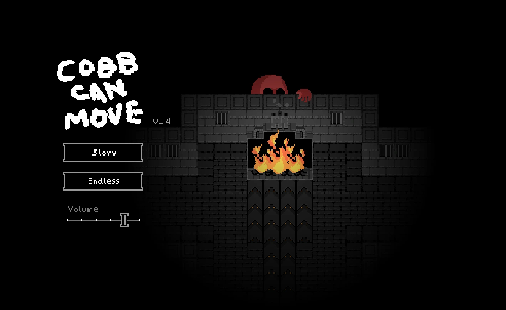
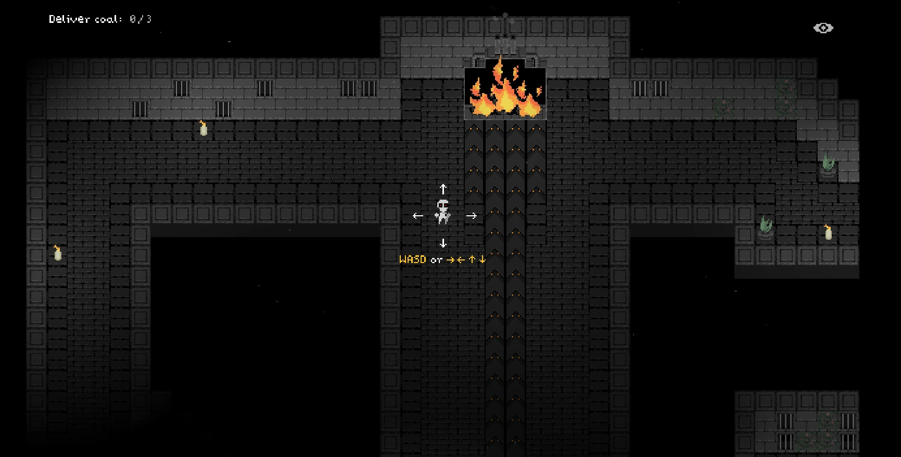

# COBB CAN MOVE

[Visit COBB CAN MOVE](https://cobb-can-move.net/)

## Explore the Website

COBB CAN MOVE may load on some mobile browsers, but it feels much better on desktop or laptop. Keyboard control, faster reactions, and a larger screen all make the shifting hazards easier to read. Keeping that note visible on the homepage helps set realistic expectations, while the Windows zip on the download page gives desktop-first players a second way to start.

What really separates COBB CAN MOVE from other browser horror games is its rule design. A room looks readable at first, then one new condition changes how movement, sound, sight, or distance works. That constant reframing is what makes the game memorable, and it is why this page focuses on gameplay context instead of repeating the title for the sake of repetition.

Start with the browser version if you want instant access, or open the Windows download page if you would rather keep a desktop copy. Both routes stay easy to reach from this homepage.

Launch COBB CAN MOVE directly in the browser, wait for the frame to load, and use fullscreen once it is ready. This is the fastest way to test the game without downloading anything first.

Download COBB-CAN-MOVE-v1.5-win.zip if you want the Windows package for desktop play. The download page includes the direct file link and a short setup overview before you begin.

COBB CAN MOVE works because it starts from clarity. At first, the room seems readable, the path looks manageable, and the objective feels obvious. Then the game shifts one rule, and that confidence begins to collapse. Movement, light, spacing, and sound all change meaning once Cobb gains a new way to track you.

That slow accumulation gives the game a strong rhythm. Instead of teaching through a long tutorial, it teaches through pressure, failure, and quick adjustment. Each loss usually has a clear cause, which is why the game feels harsh without feeling random.

In COBB CAN MOVE, movement and restraint matter equally. The controls are simple, but the smarter habit is learning when not to move. If Cobb can hear, careless steps become risky. If Cobb can see, light stops feeling safe. If smell becomes part of the rule set, the best route is usually the less obvious one.

Start every run by reading the level text carefully. The game usually tells you what matters first, but it will not pause politely once the danger begins. Find the objective, think about your return route, and assume every action can change how the room behaves.

COBB CAN MOVE runs best in a desktop or laptop browser with a keyboard. The embedded player here is meant for quick browser access, and fullscreen helps once you want a more focused run. If the game takes a few seconds to appear, give it a moment before refreshing because the assets may still be loading.

## Plan Your Visit

If the frame still refuses to show, open the full-page build from the footer and check whether extensions are blocking iframes, scripts, or storage. Mobile browsers may display the game, but this is not a touch-first experience and it is much easier to judge on a keyboard.

Treat every new line of level text as important. The game is usually honest about danger, but it expects you to remember that information while the pressure is rising. Break line of sight when vision matters, keep movement short when sound matters, and give yourself more space the moment the room starts feeling smaller.

Do not rush just because the controls look simple. The obvious route is often the noisy, bright, or overly tight route. A good run feels less like charging forward and more like slipping through a dangerous place without asking it to notice you.

The best walkthrough habit is treating every failed run like a map note. If a route breaks, ask what changed: did Cobb hear you, see you, smell you, or simply gain enough reach that your usual spacing stopped working? The game becomes easier once you classify mistakes by rule instead of by panic.

One of the strongest habits is planning the return path before touching the objective. Many losses happen because the player solves the first problem and forgets the room will feel different on the way back. The best runs are built around two routes, not one.

If you want one simple rule to remember, slow down whenever the room starts feeling smaller. The game often punishes the second rushed move more than the first. A short pause to rethink the active warning can save an entire run.

Cobb is memorable because the game does not need long lore dumps to make the threat work. The real identity of Cobb comes from the surrounding rule set. Every warning changes the meaning of the same hallway, the same switch, and the same patch of darkness.

That design gives the game a surprising amount of depth even without route branches. A failed run tells you what broke first: patience, awareness, spacing, or route planning. Reading it that way makes the experience feel more layered than a short browser horror game may look at first glance.

For players who enjoy mechanical horror, this is what sets the game apart. The fear comes from how the room teaches you one way to think, then punishes you for thinking the same way one rule later.

COBB CAN MOVE is a short top-down horror game built around changing room rules. You move, react, and adapt while each new warning makes the same space feel less reliable and more dangerous.

Yes. Press Play above and COBB CAN MOVE opens directly in the embedded browser frame, so you can start a run without leaving the homepage.

## Visit Online

[Open COBB CAN MOVE](https://cobb-can-move.net/) to explore the website and choose your next activity.
